# Portfolio personal — Iara Uriarte

Portfolio web de una página creado como trabajo final de Diseño UX/UI de la Licenciatura en Sistemas de Información (FCyT, UADER).

## Enlaces

- **Sitio publicado:** [portfolio-uriarteiara.netlify.app](https://portfolio-uriarteiara.netlify.app/)
- **Repositorio:** [github.com/IaraUriarte/PortfolioWeb](https://github.com/IaraUriarte/PortfolioWeb)
- **Archivo de Figma:** [Portfolio — research, wireframes, design system y prototipo](https://www.figma.com/design/Nw4aP7B5C6ZdLXoTd7lvn7/Portfolio?node-id=31-848&t=o8x9XmZ3teSHozW6-1)

## Sobre el proyecto

El sitio reúne mis proyectos, habilidades, formación y datos de contacto en una página adaptable a distintos tamaños de pantalla. Incluye navegación por anclas, menú hamburguesa para mobile, tema claro/oscuro y casos de estudio en ventanas de diálogo.

## Tecnologías

- HTML5 semántico
- CSS3: Flexbox, Grid, variables y media queries
- JavaScript vanilla
- Google Fonts: Montserrat
- Git y GitHub
- Netlify
- Imágenes optimizadas en WebP

No requiere dependencias ni un paso de compilación.

## Proyectos

| Proyecto           | Descripción                                                             | Sitio                                                      |
| ------------------ | ------------------------------------------------------------------------ | ---------------------------------------------------------- |
| Portfolio personal | Presentación de proyectos, formación y perfil profesional.             | [Visitar](https://portfolio-uriarteiara.netlify.app/)       |
| Cubrí Seguros     | Sitio para presentar coberturas y comenzar una cotización digital.      | [Visitar](https://cubriseguross.netlify.app/)               |
| Coffea Landing     | Landing page para una cafetería, su menú y su propuesta de panadería. | [Visitar](https://coffea-landing-uriarte-iara.netlify.app/) |

Cada proyecto incluye un caso de estudio en el sitio.

## Capturas

| Portfolio personal                                    | Cubrí Seguros                               | Coffea Landing                                |
| ----------------------------------------------------- | -------------------------------------------- | --------------------------------------------- |
| 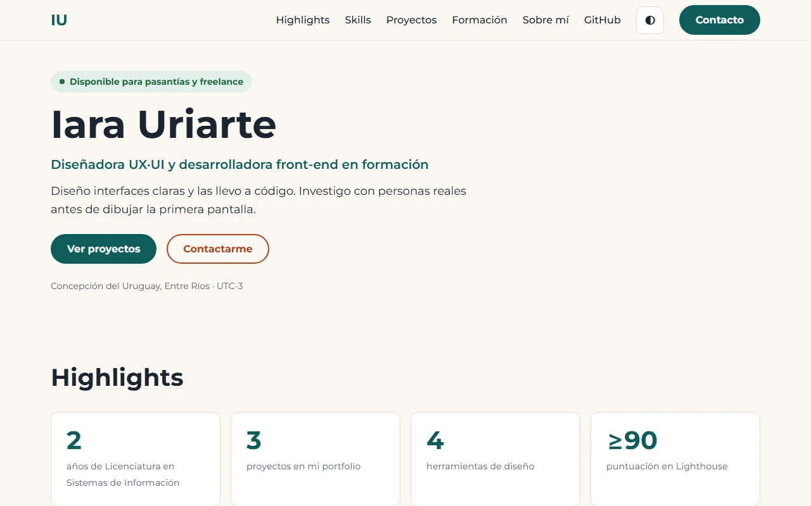 | 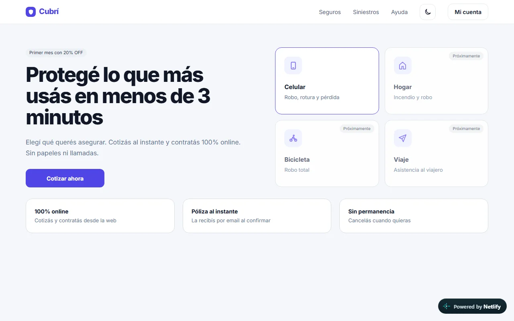 | 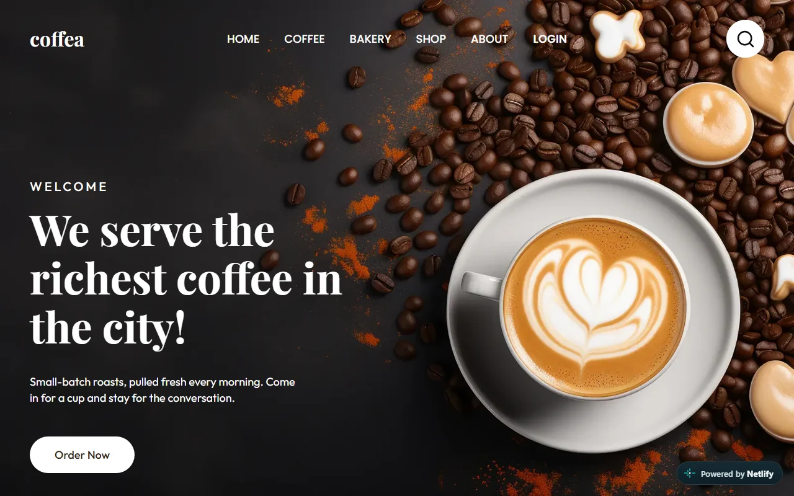 |

## Comparación Figma e implementación

Sección de proyectos en el diseño de Figma y en el sitio implementado:

| Figma                                                                 | Implementado                                                                   |
| --------------------------------------------------------------------- | ------------------------------------------------------------------------------ |
| 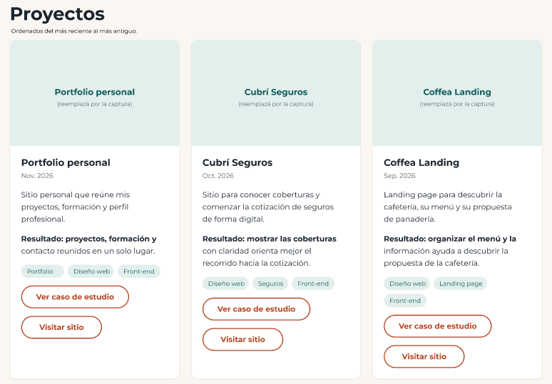 | 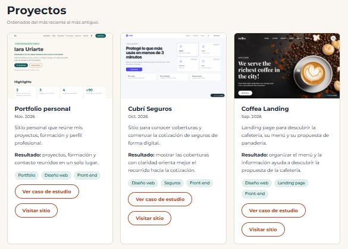 |

Hero en el diseño de Figma y en el sitio implementado:

| Figma                                                       | Implementado                                                         |
| ----------------------------------------------------------- | -------------------------------------------------------------------- |
| 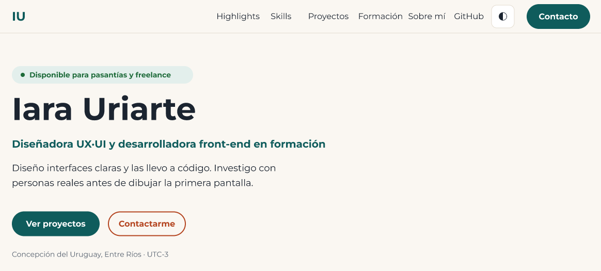 | 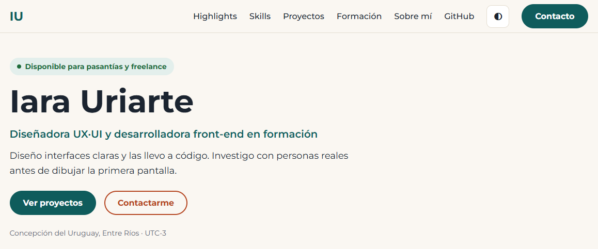 |

Hero en mobile:

| Figma | Implementado |
| ----- | ------------ |
| 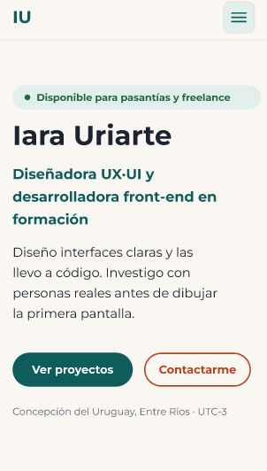 | 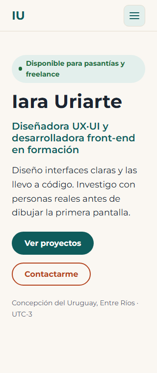 |

Las capturas corresponden a anchos de viewport distintos: 302 px en Figma y 320 px en el sitio. Se muestran al mismo ancho en esta documentación, sin alterar sus proporciones.

Menú mobile abierto en el diseño de Figma y en el sitio implementado:

| Figma                                               | Implementado                                            |
| --------------------------------------------------- | ------------------------------------------------------- |
| 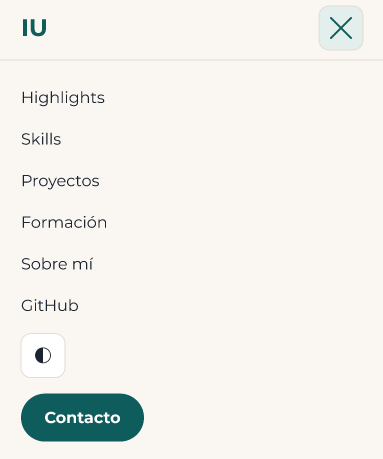 | 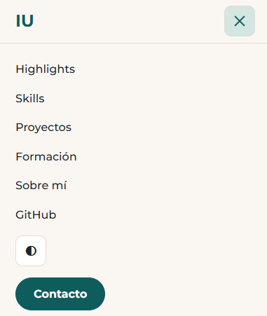 |

Sección Highlights en Figma y en la aplicación:

| Figma                                                     | Aplicación                                                      |
| --------------------------------------------------------- | ---------------------------------------------------------------- |
| 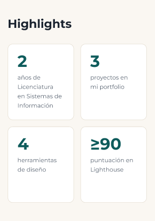 | 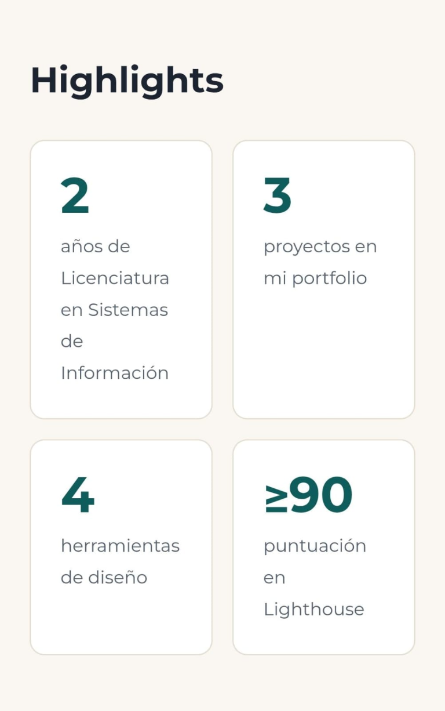 |

## Secciones del sitio

- Highlights
- Skills de UX, UI, front-end y herramientas
- Proyectos con casos de estudio
- Formación
- Sobre mí
- Contacto

## Contacto

- **Email:** [iaraherlein0001@gmail.com](mailto:iaraherlein0001@gmail.com)
- **LinkedIn:** [linkedin.com/in/iara-uriarte-675148448](https://www.linkedin.com/in/iara-uriarte-675148448/)
- **GitHub:** [github.com/IaraUriarte](https://github.com/IaraUriarte)

## Recursos y créditos

- Tipografía Montserrat: [Google Fonts](https://fonts.google.com/specimen/Montserrat).
- Las capturas de proyectos corresponden a sus respectivos sitios publicados.
- El retrato fue provisto por la autora del portfolio.

## Deploy

El sitio se publica en Netlify desde el repositorio de GitHub. No necesita comando de build; el directorio de publicación es la raíz del repositorio. La página `404.html` personalizada se sirve para las rutas inexistentes. Al subir cambios a la rama principal, Netlify genera un nuevo deploy.

Vista de la página 404 personalizada:

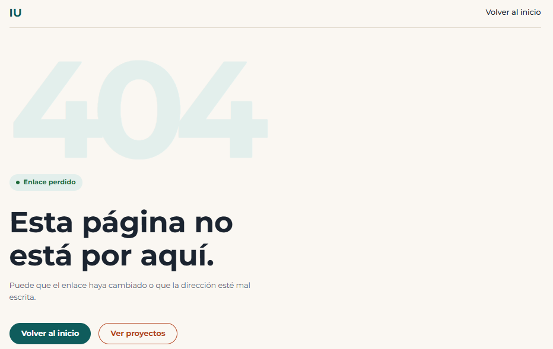

## Entregables del proceso

- **Figma (research, wireframes, design system y prototipo):** [Ver archivo](https://www.figma.com/design/Nw4aP7B5C6ZdLXoTd7lvn7/Portfolio?node-id=31-848&t=o8x9XmZ3teSHozW6-1).
- **Lighthouse mobile:** Performance 94, Accessibility 100, Best Practices 100 y SEO 100.

  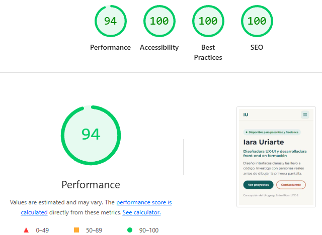
